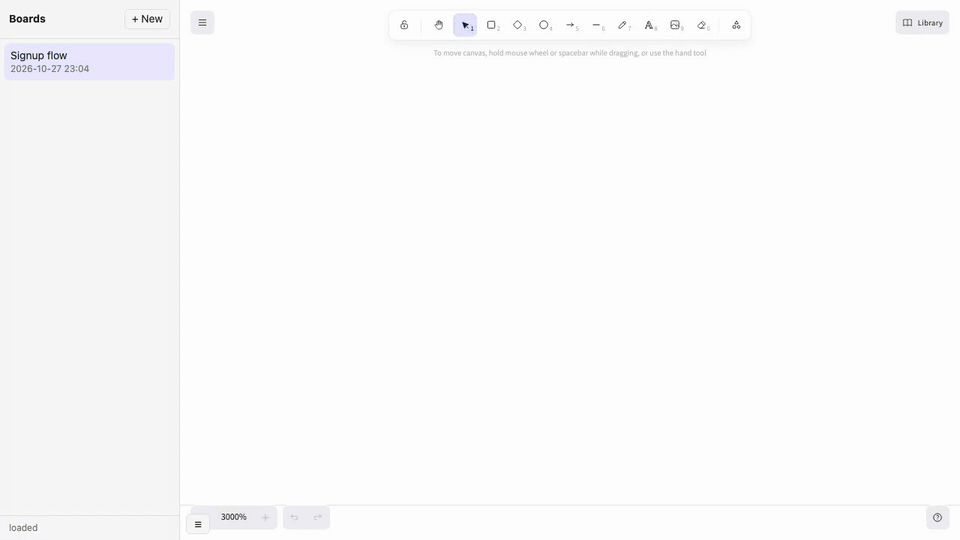

# Excalidraw skill for AI agents

[Русская версия](README.ru.md)

**Your agent draws on a real board. You fix it by hand. It remembers.**

Say "draw how our signup works" to Claude Code, Codex, Gemini CLI, Cursor or any
agent with [Agent Skills](https://agentskills.io) — and get a link to a
hand-drawn Excalidraw board you can keep editing. On your computer or your own
server, no accounts.



```sh
npx skills add na-bal/excalidraw-skill
```

Or give your agent this page and say "install this skill" — it sets everything
up and shows you a welcome board.

- **Your edits stay.** Each part of a board is a frame. The agent redraws only its
  own frame, so what you moved or renamed by hand survives.
- **It learns your taste.** It looks at what you changed by hand and what you
  said ("less color", "database on the right") and applies it next time.
- **It looks before it shows you.** Every diagram is rendered with Excalidraw's
  own fonts in headless Chromium, so clipped labels and overlaps get caught first.
- **Real, editable diagrams**, not images: every box and arrow is an Excalidraw
  object you can move.
- **Mermaid too.** "Make it a mermaid sequence diagram" becomes an editable board,
  no copy-pasting into dialogs.
- **450+ icons** from the Excalidraw libraries: people, databases, clouds, devices.

Works with Claude Code, OpenAI Codex, Gemini CLI, Cursor, GitHub Copilot,
OpenCode, Amp, Goose, Devin/Windsurf.

<details>
<summary><b>Gallery: what it can draw (7 diagrams)</b></summary>

All drawn by an agent with this skill, from short plain-language requests. Open any `.excalidraw` file at [excalidraw.com](https://excalidraw.com) or in the local board to see it's all editable.

**Architecture** — zones, icons, a queue and an external service · [`.excalidraw`](docs/gallery/architecture.excalidraw)


**Sequence diagram** — from Mermaid: OAuth login with notes and an alt block · [`.excalidraw`](docs/gallery/sequence.excalidraw)


**Customer journey** — stages, an emotion curve, drop-off and pain points · [`.excalidraw`](docs/gallery/journey.excalidraw)


**Roadmap** — three tracks on a time axis, status, a milestone and a today line · [`.excalidraw`](docs/gallery/roadmap.excalidraw)


**Mind map** — a hub, six branches, curved connectors · [`.excalidraw`](docs/gallery/mindmap.excalidraw)


**Decision + comparison** — two questions and three options with pros and cons · [`.excalidraw`](docs/gallery/comparison.excalidraw)


**Explainer** — how a long meeting becomes a summary, chunk by chunk · [`.excalidraw`](docs/gallery/explainer.excalidraw)


</details>

## Pick where your boards live

| | What you get | What you need |
|---|---|---|
| **Local** (default) | Boards are `.excalidraw` files in a folder on your computer. You view and edit them in a local board at `http://127.0.0.1:3200`. | Nothing extra |
| **Your own server** | A self-hosted [ExcaliDash](https://github.com/ZimengXiong/ExcaliDash): boards with links, history, login, sharing with your team | A small VPS with Docker, a domain |
| **Need help with hosting?** | Don't want to run a server yourself — ask the author | A message (see below) |

You can switch later by re-running setup.

## Install

**Fastest, for any agent** (needs Node 22+):

```sh
npx skills add na-bal/excalidraw-skill
```

Or just give your agent this repo's link and say "install this skill". The
section below tells it what to do.

Per agent, by hand:

| Agent | Command or folder |
|---|---|
| Claude Code | `claude plugin marketplace add na-bal/excalidraw-skill` then `claude plugin install excalidraw@excalidraw-skill`, or copy `skills/excalidraw` into `~/.claude/skills/` |
| Codex, Cursor, Copilot, OpenCode, Amp, Goose, Devin | copy `skills/excalidraw` into `~/.agents/skills/` |
| Gemini CLI | `gemini skills install https://github.com/na-bal/excalidraw-skill --path skills/excalidraw` |
| Antigravity | copy `skills/excalidraw` into `~/.gemini/config/skills/` |

Then run setup once. Your agent will do it on first use if you don't:

```sh
bash ~/.agents/skills/excalidraw/scripts/setup.sh      # asks a couple of questions
```

Setup checks Python 3.10+ and Node 18+. It downloads a headless Chromium (~120 MB) into
Playwright's shared cache (reused if you already have it), writes `~/.config/excalidraw-skill/config` and
draws a test diagram. Nothing goes into the skill folder, so updating the skill
never breaks the install.

## For AI agents: how to install this skill

1. Pick the target folder: Claude Code → `~/.claude/skills/`; Antigravity →
   `~/.gemini/config/skills/`; any other agent → `~/.agents/skills/`.
   If `npx` is available, `npx skills add na-bal/excalidraw-skill -g -y -a <your-agent-id>`
   does steps 1–2 for you.
2. `git clone --depth 1 https://github.com/na-bal/excalidraw-skill /tmp/excalidraw-skill && cp -R /tmp/excalidraw-skill/skills/excalidraw <target>/`
3. Run `bash <target>/excalidraw/scripts/setup.sh --backend local` — no questions
   first. Success means it printed `Ready.`. Exit codes: 1 is a missing requirement
   (tell the user what to install), 3 is a failed smoke test (show the output).
4. Show the result: `python3 <target>/excalidraw/scripts/board.py open` opens the
   Welcome board drawn on their machine.
5. Then ask where boards should live from now on:
   - **this computer** — as now, nothing to do;
   - **their own server** — help them set up ExcaliDash step by step:
     [`skills/excalidraw/references/self-host.md`](skills/excalidraw/references/self-host.md).
     At the end the user runs `bash <target>/excalidraw/scripts/setup.sh --backend excalidash --url <url>`
     in their own terminal, so the API key never passes through the chat;
   - **help with hosting from the author** — Telegram [@Ohio_blue_tip](https://t.me/Ohio_blue_tip) or bdlv@bdlv.me.

   Then `touch ~/.config/excalidraw-skill/.onboarded`.
6. Reload skills or restart: Claude Code `/reload-skills`, Gemini `/skills reload`,
   others need a restart.
   Tell the user they can now just say "draw…", "put it on the board" or "what's on
   my board" in any conversation.

Heads-up: setup downloads Chromium, so cloud sandboxes without network access
won't work.

## Running your own board server

Short checklist your agent follows to walk you through it:
[`references/self-host.md`](skills/excalidraw/references/self-host.md).

The `excalidash` backend talks to [ExcaliDash](https://github.com/ZimengXiong/ExcaliDash).
It's a self-hosted Excalidraw with named boards, collections, version history,
login and API keys. Install it with Docker following its README, then create an
API key in its settings and run `setup.sh --backend excalidash`.

Tested with ExcaliDash 0.6.0. Things that cost time on a real install:

- **Behind a reverse proxy, set `TRUST_PROXY=2`**, not 1. That's two hops: your
  proxy (Caddy/nginx) plus nginx inside the frontend container. With 1, the
  backend sees the Docker gateway as every client, and the login rate limiter
  locks everyone out at once.
- **Several people on one server:** API keys are isolated (a key sees only its owner's
  boards and what was shared with them), but any logged-in user can look up other
  users by part of their email in the share dialog. Keep registration closed and
  create accounts yourself; for strangers, run one instance per person.
- **Set `API_KEY_HASH_PEPPER` before creating the first API key.** Changing it
  later invalidates every key.
- **Google login:** set `OIDC_JIT_PROVISIONING=false`. Otherwise any Google
  account gets an auto-created user with access to the boards.
- **New subdomain:** check the whole DNS zone, not just your record. Some
  registrar panels add extra A/AAAA records by themselves, and a stray AAAA
  breaks the Let's Encrypt http-01 check.
- **Small VPS:** 1 CPU and 1 GB RAM is enough. Set `mem_limit` on the containers
  if the machine runs anything else.

Two known rough edges in the editor:
- Trackpad two-finger pan zooms instead of panning (upstream PR #266, not merged
  yet).
- Shortcuts don't work on non-Latin keyboard layouts (fixed in ExcaliDash `dev`,
  not yet released).

The local board in this skill already has the keyboard fix.

## Need help with hosting?

Don't want to run a server yourself? Write to me and we'll figure something out: Telegram [@Ohio_blue_tip](https://t.me/Ohio_blue_tip) or [bdlv@bdlv.me](mailto:bdlv@bdlv.me).

## Reporting problems

If something in the skill breaks, your agent offers to send a report to the
author. It shows you the full text first: the error and versions. Home paths,
keys, emails and IPs are stripped automatically. Nothing is sent without your
explicit yes, and no account is needed. The receiving end is in
[`server/report-relay`](server/report-relay), so you can see exactly where it goes.

You can also write to me directly: Telegram [@Ohio_blue_tip](https://t.me/Ohio_blue_tip) or
[bdlv@bdlv.me](mailto:bdlv@bdlv.me).

## Privacy

- **Local mode:** your drawings never leave your computer. The local board and
  the renderer load Excalidraw's code from public CDNs (esm.sh, jsdelivr), so
  first use needs internet. Your scenes are not sent anywhere.
- **Server mode:** scenes go only to the server you configured.
- The skill never uses excalidraw.com sharing unless you explicitly ask.

## What's inside

```
skills/excalidraw/
  SKILL.md            instructions for the agent
  scripts/setup.sh    install + configure + smoke test
  scripts/board.py    boards: push/get/list/open, local board server, frames
  scripts/scene.py    scene building blocks (box, connect, curve, code_card…)
  scripts/stamps.py   450+ icons from Excalidraw libraries
  scripts/mmd/        headless Excalidraw: Mermaid → scene, font fitting, screenshots
  scripts/viewer/     the local board page
  scripts/report.py   bug reports to the author, shown to you first
  scripts/welcome.py  your first board: a note from the author
server/report-relay/  the service that receives reports
  references/         patterns, recipes, Mermaid notes for the agent
```

Your data lives outside the skill: `~/.config/excalidraw-skill/` holds config,
`learned.md` and `usage.json`; `~/.cache/excalidraw-skill/` holds Playwright and
snapshots; the drawings folder is whatever you picked.

## License

MIT. Icon libraries come from [libraries.excalidraw.com](https://libraries.excalidraw.com)
(MIT); their authors are in the file names.
