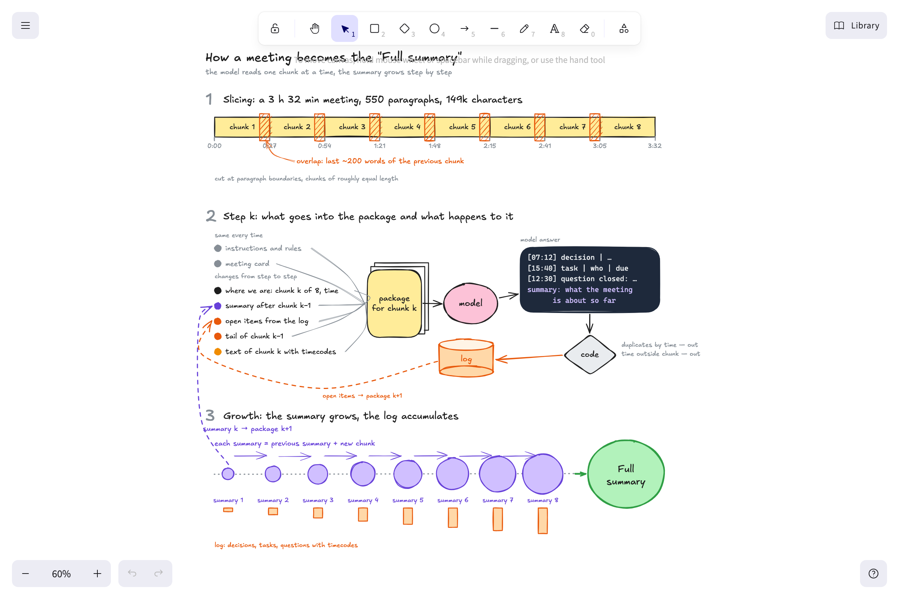

# Скилл Excalidraw для ИИ-агентов

[English version](README.md)

Агент рисует схемы в Excalidraw. Сначала он продумывает картинку, потом собирает сцену кодом. Результат он смотрит через настоящий движок редактора и правит то, что криво. В конце ты получаешь ссылку на доску, где схему можно дальше править руками.



- **Схемы от руки, которые можно править.** Не картинка, а живые объекты Excalidraw: каждую коробку и стрелку можно двигать и менять.
- **Сначала смотрит сам, потом показывает.** Каждая схема рендерится в безголовом Chromium с родными шрифтами Excalidraw, поэтому обрезанные надписи и наложения ловятся до тебя.
- **Одна доска на разговор.** Каждая часть доски — отдельный фрейм. Агент перерисовывает только свой фрейм, твои правки руками остаются.
- **Mermaid тоже.** «Сделай sequence-диаграмму на mermaid» превращается в доску, которую можно править. Ничего не надо копировать в диалоги.
- **450+ значков** из библиотек Excalidraw: люди, базы, облака, устройства. Агент ставит готовые значки, а не собирает их из кружочков.
- **Учится твоему вкусу.** Замечания вроде «поменьше цвета» или «база справа» записываются в короткий файл заметок и в следующий раз учитываются.

Работает с любым агентом, который поддерживает [Agent Skills](https://agentskills.io): Claude Code, OpenAI Codex, Gemini CLI, Cursor, GitHub Copilot, OpenCode, Amp, Goose, Devin/Windsurf.

## Где будут жить доски

| | Что получаешь | Что нужно |
|---|---|---|
| **Локально** (по умолчанию) | Доски — файлы `.excalidraw` в папке на компьютере. Смотришь и правишь их на локальной доске `http://127.0.0.1:3200` | Ничего |
| **Свой сервер** | Свой [ExcaliDash](https://github.com/ZimengXiong/ExcaliDash): доски со ссылками, историей версий, входом по логину, доступом для команды | Небольшой VPS с Docker и домен |
| **Готовая доска** | То же, что свой сервер, только поднимать его не надо | Напиши автору (ниже) |

Переключиться можно в любой момент: заново запусти setup.

## Установка

**Быстрее всего, для любого агента** (нужен Node 22+):

```sh
npx skills add na-bal/excalidraw-skill
```

Или просто дай агенту ссылку на этот репозиторий и скажи «установи скилл». В английском README есть раздел «For AI agents» с шагами, агент сделает всё по нему: поставит всё локально, откроет приветственную доску и спросит, где хранить доски дальше — на компьютере, на своём сервере или на готовой доске у автора.

Вручную, по агентам:

| Агент | Команда или папка |
|---|---|
| Claude Code | `claude plugin marketplace add na-bal/excalidraw-skill`, потом `claude plugin install excalidraw@excalidraw-skill`. Или скопируй `skills/excalidraw` в `~/.claude/skills/` |
| Codex, Cursor, Copilot, OpenCode, Amp, Goose, Devin | скопируй `skills/excalidraw` в `~/.agents/skills/` |
| Gemini CLI | `gemini skills install https://github.com/na-bal/excalidraw-skill --path skills/excalidraw` |
| Antigravity | скопируй `skills/excalidraw` в `~/.gemini/config/skills/` |

Потом один раз запусти setup. Если не запустишь сам, агент сделает это при первом использовании:

```sh
bash ~/.agents/skills/excalidraw/scripts/setup.sh      # задаст пару вопросов
```

Что делает setup:
- проверяет Python 3.10+ и Node 18+;
- скачивает безголовый Chromium (~120 МБ) в общий кэш Playwright (если он уже есть, берёт готовый);
- пишет конфиг в `~/.config/excalidraw-skill/config`;
- рисует пробную схему.

В папку скилла setup ничего не пишет, поэтому обновление скилла установку не ломает.

## Свой сервер для досок

Бэкенд `excalidash` работает с [ExcaliDash](https://github.com/ZimengXiong/ExcaliDash). Это Excalidraw на своём сервере: именованные доски, коллекции, история версий, вход по логину и API-ключи.

Короткая инструкция, по которой агент проведёт тебя по шагам, — [`references/self-host.md`](skills/excalidraw/references/self-host.md) (на английском). Если коротко:
1. Поставь ExcaliDash через Docker по его README.
2. В настройках ExcaliDash создай API-ключ.
3. Запусти `setup.sh --backend excalidash`.

Проверено на ExcaliDash 0.6.0. На живой установке время ушло на это:

- **За реверс-прокси нужен `TRUST_PROXY=2`, а не 1.** Хопов два: твой Caddy или nginx и nginx внутри фронт-контейнера. С единицей бэкенд считает каждого клиента докер-шлюзом, и лимитер входа блокирует всех сразу.
- **Несколько человек на одном сервере:** API-ключи изолированы (ключ видит только доски владельца и то, чем с ним поделились), но любой вошедший может искать других пользователей по куску почты в окне «Поделиться». Регистрацию держи закрытой, учётки заводи сам; для незнакомых людей — отдельный экземпляр на каждого.
- **`API_KEY_HASH_PEPPER` задай до первого API-ключа.** Если поменять его потом, все выданные ключи перестанут работать.
- **Вход через Google:** ставь `OIDC_JIT_PROVISIONING=false`. Иначе любой гугл-аккаунт получит автоматически созданную учётку и доступ к доскам.
- **Новый поддомен:** проверяй DNS-зону целиком, а не только свою запись. Некоторые панели регистраторов сами дописывают A- и AAAA-записи, а лишняя AAAA ломает проверку Let's Encrypt http-01.
- **Маленький VPS:** хватает 1 ядра и 1 ГБ памяти. Если на машине работает что-то ещё, поставь контейнерам `mem_limit`.

В редакторе ExcaliDash пока две шероховатости:
- Жест двумя пальцами на трекпаде зумит вместо панорамы. Исправление — PR #266, его пока не влили.
- Хоткеи не работают на русской раскладке. В ветке `dev` это уже исправлено, в релиз пока не попало.

На локальной доске из этого скилла хоткеи на русской раскладке уже работают.

## Готовая доска

Не хочешь поднимать сервер? Могу разместить доску для тебя: со своим входом и ссылкой, которую можно дать команде. Пиши в телеграм [@Ohio_blue_tip](https://t.me/Ohio_blue_tip) или на [bdlv@bdlv.me](mailto:bdlv@bdlv.me).

## Если что-то сломалось

Если в скилле что-то сломалось, агент предложит отправить отчёт автору.
Сначала он покажет текст целиком: ошибку и версии. Домашние пути, ключи, почты
и IP вычищаются автоматически. Без твоего явного «да» ничего не уходит, аккаунт
не нужен. Приёмник отчётов лежит в [`server/report-relay`](server/report-relay):
можно посмотреть, куда именно всё уходит.

Можно и написать мне напрямую: телеграм [@Ohio_blue_tip](https://t.me/Ohio_blue_tip) или
[bdlv@bdlv.me](mailto:bdlv@bdlv.me).

## Приватность

- **Локальный режим:** рисунки не покидают компьютер. Код Excalidraw локальная доска и рендер берут с публичных CDN (esm.sh, jsdelivr), поэтому при первом запуске нужен интернет. Сами сцены никуда не отправляются.
- **Режим сервера:** сцены уходят только на твой сервер.
- Публичными ссылками excalidraw.com скилл не пользуется, если ты сам об этом не попросишь.

## Где лежат твои данные

Данные хранятся отдельно от скилла:
- `~/.config/excalidraw-skill/` — конфиг, `learned.md` (заметки агента) и `usage.json`;
- `~/.cache/excalidraw-skill/` — Playwright и снимки фреймов;
- папка с рисунками — та, которую ты выбрал при установке.

## Лицензия

MIT. Библиотеки значков взяты с [libraries.excalidraw.com](https://libraries.excalidraw.com) (MIT), авторы указаны в именах файлов.
